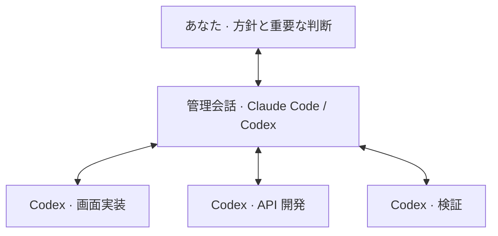

# Agbrio

**Agent の作業は PC で。進捗の確認と次の指示はスマートフォンから。**

[English](README.md) · [简体中文](README.zh-CN.md) · [繁體中文](README.zh-TW.md) · [日本語](README.ja.md) · [한국어](README.ko.md)

Codex と Claude Code の会話を確認し、返信して作業を進める。新しい結果や判断が必要なときは通知を受け取れます。計画と実行を分担したり、ひとつの管理会話に複数の実行会話を任せたりできます。

## 外出先でも、進捗を見て返信する

実行中・確認待ち・子会話の状態を一覧で把握。元の会話で結果を読み、追加の指示や対応している質問への回答ができます。

 &nbsp; 

## 会話を選んで、監視や連携を始める

PC 上の既存の会話を選択。ひとつの会話を追跡することも、計画役と実行役を Bridge でつなぐこともできます。転送する内容と相手を確認し、あなたが承認します。

 &nbsp; 

## 日々の確認を管理会話に任せる

ひとつの管理会話が複数の Codex 会話の進捗を読み、タスクを伝え、結果をまとめます。判断が必要な場面はあなたへ。管理側には Claude Code または Codex を使えます。

委任したメッセージの送信先は Codex です。Claude Code にはスマートフォンから本人が返信できます。判断と委任範囲はあなたが管理します。

## 使い始める

1. Windows 版をダウンロードし、使用中の Agent を接続。
2. 会話を選んで追跡するか、管理役と実行役を接続。
3. 設定 → デバイスでスマートフォンをペアリングし、Agbrio の URL を開く。

PC と Agbrio はオンラインにしておいてください。受信端末で通知を有効にしてください。

[Download](https://github.com/geoffrey1111/agbrio/releases/latest) · [セットアップ](docs/START_HERE.md)

そのほかの便利な機能

会話内の文書・画像・プロジェクトボードも閲覧できます。独自の連携には API / MCP を利用できます。

画像は現在の画面を使った架空のデモデータです。
