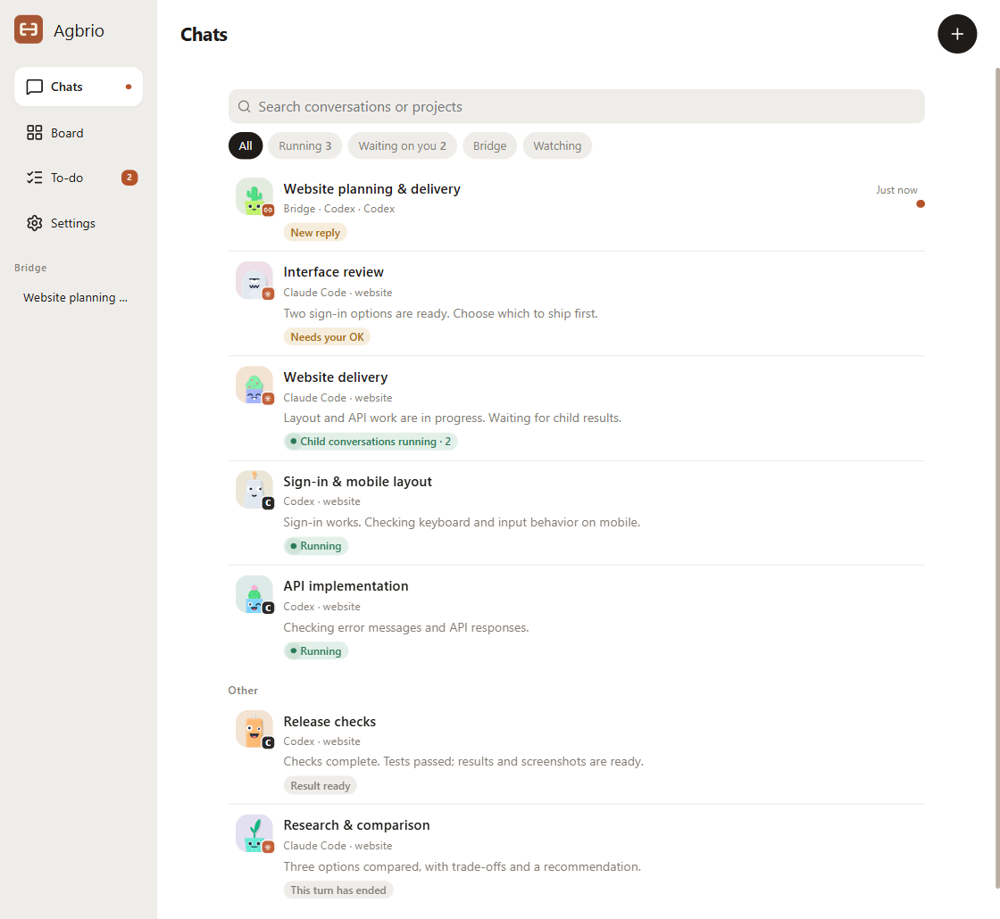
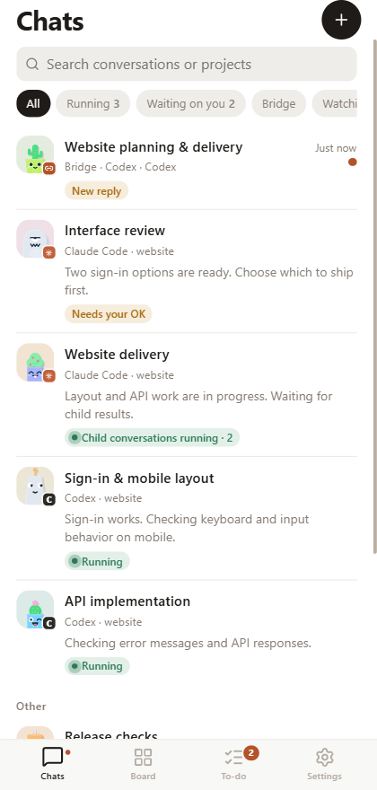
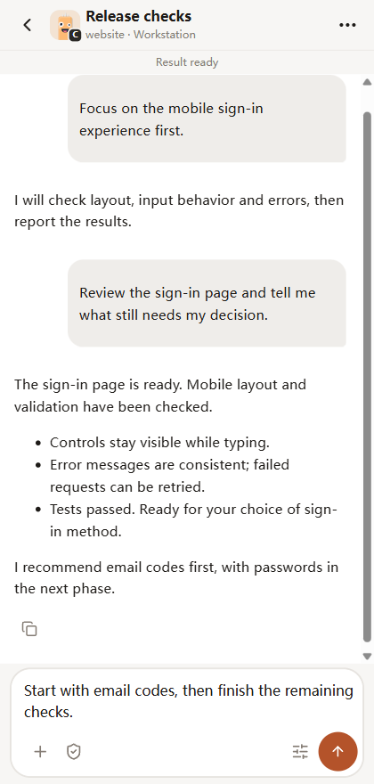
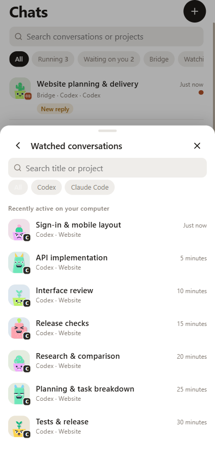
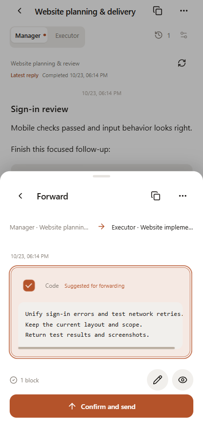
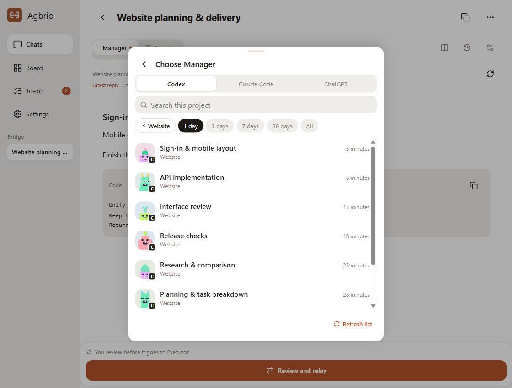
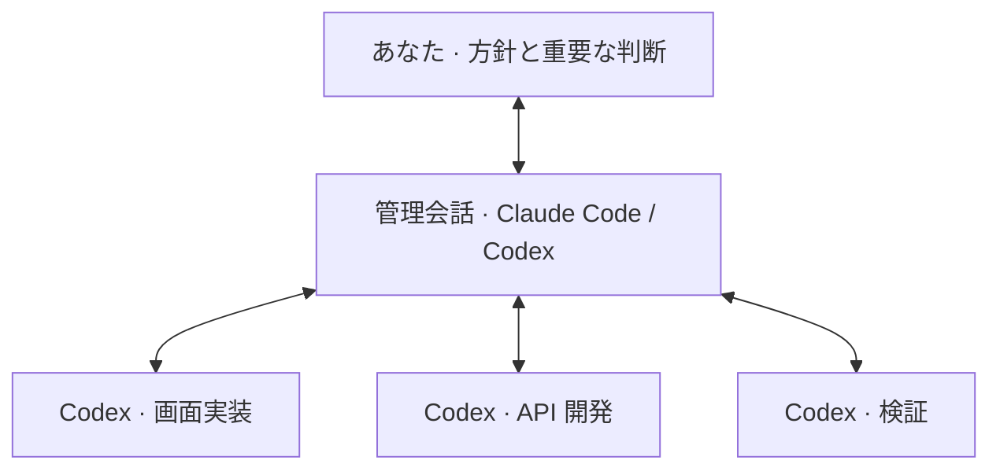

# Agbrio

**Agent の作業は PC で。進捗の確認と次の指示はスマートフォンから。**

**[Windows をダウンロード](https://github.com/geoffrey1111/agbrio/releases/latest) · [macOS テスト版をダウンロード（Apple Silicon）](https://github.com/geoffrey1111/agbrio/releases/tag/macos-beta-2026-11-05-rc122-sync)**

[English](README.md) · [简体中文](README.zh-CN.md) · [繁體中文](README.zh-TW.md) · [日本語](README.ja.md) · [한국어](README.ko.md)

> Mac 公開テスト版：Apple Silicon のみ。実機検証は未実施です。[制限は Mac Beta 節を参照](#mac-beta)。

Codex と Claude Code の会話を確認し、返信して作業を進める。新しい結果や判断が必要なときは通知を受け取れます。計画と実行を分担したり、ひとつの管理会話に複数の実行会話を任せたりできます。

## 外出先でも、進捗を見て返信する

実行中・確認待ち・子会話の状態を一覧で把握。元の会話で結果を読み、追加の指示や対応している質問への回答ができます。

 &nbsp; 

## 会話を選んで、監視や連携を始める

PC 上の既存の会話を選択。ひとつの会話を追跡することも、計画役と実行役を Bridge でつなぐこともできます。転送する内容と相手を確認し、あなたが承認します。

 &nbsp; 

## 日々の確認を管理会話に任せる

ひとつの管理会話が複数の Codex 会話の進捗を読み、タスクを伝え、結果をまとめます。判断が必要な場面はあなたへ。管理側には Claude Code または Codex を使えます。

委任したメッセージの送信先は Codex です。Claude Code にはスマートフォンから本人が返信できます。判断と委任範囲はあなたが管理します。

## 使い始める

1. Windows 版をダウンロードし、使用中の Agent を接続。
2. 会話を選んで追跡するか、管理役と実行役を接続。
3. 設定 → デバイスでスマートフォンをペアリングし、Agbrio の URL を開く。

PC と Agbrio はオンラインにしておいてください。受信端末で通知を有効にしてください。

[Download](https://github.com/geoffrey1111/agbrio/releases/latest) · [セットアップ](docs/START_HERE.md)

そのほかの便利な機能

会話内の文書・画像・プロジェクトボードも閲覧できます。独自の連携には API / MCP を利用できます。

画像は現在の画面を使った架空のデモデータです。

## Mac Beta

Windows rc.122 の管理エリア、星図ビュー、初回ガイドを同期しました。Mac では Pi、共有 Codex、アプリ内更新は引き続き利用できません。初回ガイドでは未対応の共有 Codex をスキップします。Claude MCP は元の Code 会話で手動接続します。

**Mac 公開テスト版：Apple Silicon（ARM64）のみ。正式な macOS 対応ではなく、協力者所有 Mac での実機検証は未実施です。不具合の可能性があります。** Intel Mac は対象外です。macOS 13.5 は宣言された最低版で、OS／機種の検証は未完了です。GitHub Mac CI は工程検証であり、実機 UAT や Windows 同等の証明ではありません。上記の一般紹介は主に Windows 向けで、Mac には本節の制限が適用されます。

[Mac テスト Release](https://github.com/geoffrey1111/agbrio/releases/tag/macos-beta-2026-11-05-rc122-sync) · [DMG](https://github.com/geoffrey1111/agbrio/releases/download/macos-beta-2026-11-05-rc122-sync/Agbrio_0.1.0_aarch64.dmg) · [SHA-256](https://github.com/geoffrey1111/agbrio/releases/download/macos-beta-2026-11-05-rc122-sync/SHA256SUMS.txt) · [問題報告](https://github.com/geoffrey1111/agbrio/issues/new)

### 未署名テスト app の初回起動・本人の許可

**ad-hoc 署名のみ。Apple Developer ID 署名と公証はありません。**

1. Release の DMG と `SHA256SUMS.txt` を取得し、macOS `shasum -a 256` で完全な SHA-256 を照合してください。
2. DMG の `Agbrio.app` を Applications または自分の `~/Applications` にコピーし、DMG を取り出して Finder から起動します。
3. ブロックされ、この取得物を信頼する場合は**システム設定 → プライバシーとセキュリティ → このまま開く**を選び、本人が「開く」を確認します。[Apple の手順](https://support.apple.com/en-us/102445)。マルウェア警告やチェックサム不一致なら停止・報告してください。
4. 初回起動、通知、選択ファイル、ログイン項目の許可は本人が行います。Codex／Agent が代行してはいけません。アプリは quarantine を自動削除せず、システムの信頼設定を変更しません。

メールのパスワードと MCP Events キーは現在のユーザーのキーチェーンを使います。ad-hoc 更新で再確認される場合があり、信頼する場合のみ本人が「許可／常に許可」を選んでください。拒否・未完了では利用できない場合があります。Keychain ACL は移行しません。実アカウント、権限画面、スマートフォンの一連の操作、長期動作は未検証です。

### 利用できない機能

- **Pi：**Mac の入口、タスク、`pi-adapter` リソースはありません。
- **共有 Codex：**正式な準備／有効化／終了は未対応です。内部 app-server 模擬は実際の Codex Desktop 互換性を証明しません。他の CLI／アカウント連携も自分のインストールで検証が必要です。OpenAI インストーラー、SDK、profile は同梱・再配布しません。
- **アプリ内更新：**未対応です。新版を手動取得・チェックサム照合し、Agbrio を通常終了して app を交換してください。データ、ペアリング、履歴を削除せず、Windows 認証情報／profile をコピーしないでください。Mac は更新マニフェストに追加しません。
- **ホスト型スマートフォン接続・試用・有効化コード：**このテスト版で有効です。Mac CI は変更のないテスト用 Worker、実際の TLS/WSS、同梱 Node connector とブラウザーで、コード引き換え、試用開始、更新、ペアリング、模擬プロバイダーとの送受信を確認します。試用資格には IOPlatformUUID の用途限定ハッシュだけを使用し、元の UUID は保存・送信しません。取得できない場合はエラーにし、ランダム値で代用しません。実サービスのアカウント／利用権、実機 Mac・スマートフォンは未検証です。コードは接続用で、Codex／Claude の契約ではありません。

自分の Mac とアカウントのみを使用してください。[Issues](https://github.com/geoffrey1111/agbrio/issues/new) にチップ／機種、macOS、Release タグ、再現手順と画像／ログを記載します。送信前に個人パス、アカウント、キー／token、会話を隠し、認証情報、profile、会話 DB は送らないでください。Windows の取得／更新は既存の [Windows Latest](https://github.com/geoffrey1111/agbrio/releases/latest) のままです。
