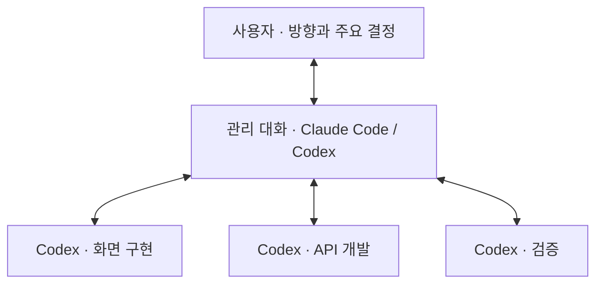

# Agbrio

**Agent는 PC에서 계속 일하고, 진행 상황은 휴대폰에서 확인하세요.**

[English](README.md) · [简体中文](README.zh-CN.md) · [繁體中文](README.zh-TW.md) · [日本語](README.ja.md) · [한국어](README.ko.md)

> Mac 공개 테스트: Apple Silicon 전용, 외부 테스터 소유 Mac의 실제 기기 검증은 아직 없습니다. [다운로드와 제한](#mac-beta).

Codex와 Claude Code 대화를 확인하고, 메시지를 보내 후속 작업을 진행하세요. 새 결과나 결정이 필요할 때 알림을 받습니다. 계획과 실행을 나누거나 하나의 관리 대화에 여러 실행 대화를 맡길 수 있습니다.

## 자리를 비워도 진행 상황을 보고 답장하기

실행 중, 확인 대기, 하위 대화 상태를 한눈에 확인하세요. 원래 대화에서 결과를 읽고 추가 지시를 보내거나 지원되는 질문에 답할 수 있습니다.

 &nbsp; 

## 대화를 선택하고 지켜보거나 연결하기

PC의 기존 대화를 선택하세요. 하나를 모니터링하거나 관리자와 실행자를 Bridge로 연결할 수 있습니다. 전달할 내용과 대상을 확인한 뒤 직접 승인합니다.

 &nbsp; 

## 관리 대화에 일상적인 후속 작업 맡기기

하나의 관리 대화가 여러 Codex 대화의 진행 상황을 읽고, 작업을 전달하며, 결과를 정리합니다. 판단이 필요한 일은 사용자에게 돌아옵니다. Claude Code나 Codex를 관리 대화로 사용할 수 있습니다.

위임한 메시지는 Codex로 전송됩니다. Claude Code에는 휴대폰에서 직접 답장할 수 있습니다. 결정과 위임 범위는 사용자가 관리합니다.

## 시작하기

1. Windows 앱을 내려받고 사용 중인 Agent를 연결하세요.
2. 모니터링할 대화를 선택하거나 관리자와 실행자를 연결하세요.
3. 설정 → 기기에서 휴대폰을 페어링하고 Agbrio 주소를 여세요.

PC와 Agbrio는 온라인 상태여야 합니다. 알림을 받을 기기에서 알림을 켜세요.

[Download](https://github.com/geoffrey1111/agbrio/releases/latest) · [설정 안내](docs/START_HERE.md)

함께 쓰기 좋은 기능

대화에 연결된 문서, 이미지, 프로젝트 보드도 볼 수 있습니다. 맞춤 연동에는 API / MCP를 사용할 수 있습니다.

현재 인터페이스에 가상의 예시 데이터를 사용한 화면입니다.

## Mac Beta

**Mac 공개 테스트 버전: Apple Silicon(ARM64) 전용. 정식 macOS 지원이 아니며 외부 테스터 소유 Mac의 실제 기기 검증이 없어 문제가 있을 수 있습니다.** Intel Mac은 지원하지 않습니다. macOS 13.5는 명시한 최소 버전일 뿐 OS/기종 검증은 미완료입니다. GitHub Mac CI는 엔지니어링 검증으로 실제 기기 UAT나 Windows 기능 동등성을 뜻하지 않습니다. 위 일반 소개는 주로 Windows에 해당하며 Mac에는 이 제한이 적용됩니다.

[Mac 테스트 Release](https://github.com/geoffrey1111/agbrio/releases/tag/macos-beta-2026-11-05) · [DMG](https://github.com/geoffrey1111/agbrio/releases/download/macos-beta-2026-11-05/Agbrio_0.1.0_aarch64.dmg) · [SHA-256](https://github.com/geoffrey1111/agbrio/releases/download/macos-beta-2026-11-05/SHA256SUMS.txt) · [문제 신고](https://github.com/geoffrey1111/agbrio/issues/new)

### 서명되지 않은 테스트 app 첫 실행과 본인 권한 확인

**ad-hoc 서명만 있고 Apple Developer ID 서명과 공증은 없습니다.**

1. Release의 DMG와 `SHA256SUMS.txt`를 받고 macOS `shasum -a 256`으로 전체 SHA-256을 비교하세요.
2. DMG의 `Agbrio.app`을 Applications 또는 자신의 `~/Applications`로 복사하고 DMG를 꺼낸 뒤 Finder에서 실행하세요.
3. 차단되고 이 파일을 신뢰한다면 **시스템 설정 → 개인정보 보호 및 보안 → 확인 없이 열기**에서 본인이 열기를 확인하세요. [Apple 안내](https://support.apple.com/en-us/102445). 악성 소프트웨어 경고나 체크섬 불일치가 있으면 중지하고 신고하세요.
4. 첫 실행, 알림, 선택 파일, 로그인 항목 권한은 본인이 처리해야 합니다. Codex/Agent가 대신 승인하면 안 됩니다. 앱은 quarantine을 자동 제거하거나 시스템 신뢰를 바꾸지 않습니다.

이메일 비밀번호와 MCP Events 키는 현재 사용자 키체인을 사용합니다. ad-hoc 업데이트로 재확인이 나타날 수 있으며 신뢰할 때만 본인이 허용/항상 허용을 선택하세요. 거부/미완료 시 기능을 사용할 수 없을 수 있고 Keychain ACL은 이전하지 않습니다. 실제 계정, 권한 창, 휴대전화 종단 간 사용과 장기 실행은 미검증입니다.

### 사용할 수 없는 기능

- **Pi:** Mac 진입점, 작업, `pi-adapter` 리소스가 없습니다.
- **공유 Codex:** 정식 준비/활성화/종료는 미지원입니다. 내부 app-server 모의 테스트는 실제 Codex Desktop 호환성을 증명하지 않습니다. 다른 CLI/계정 연동도 자신의 설치/계정으로 검증해야 합니다. OpenAI 설치 파일, SDK, profile은 포함·재배포하지 않습니다.
- **앱 내 업데이트:** 미지원입니다. 새 버전을 수동 다운로드하고 체크섬을 확인한 뒤 Agbrio를 정상 종료하고 app을 교체하세요. 데이터/페어링/기록을 삭제하거나 Windows 자격 증명/profile을 복사하지 마세요. Mac은 업데이트 매니페스트에 추가하지 않습니다.
- **호스팅 체험/코드 교환:** 이 Mac 배포물에는 호스팅 진입점이 없어 해당 기능은 사용할 수 없습니다. 안정적인 체험 기기 식별도 Windows 전용입니다. 이 테스트 버전의 호스팅 휴대전화 연결을 위해 코드를 구매/교환하지 마세요. 코드는 Codex/Claude 구독이 아닙니다. 로컬/자체 호스팅 설정은 별도 후보이며 실제 Mac/휴대전화 검증이 필요합니다.

자신의 Mac과 계정만 사용하세요. [Issues](https://github.com/geoffrey1111/agbrio/issues/new)에 칩/기종, macOS, Release 태그, 재현 단계와 화면/로그를 제출하세요. 먼저 개인 경로, 계정, 키/token, 대화를 가리고 자격 증명/profile/대화 DB는 업로드하지 마세요. Windows 다운로드/업데이트는 기존 [Windows Latest](https://github.com/geoffrey1111/agbrio/releases/latest)를 유지합니다.
