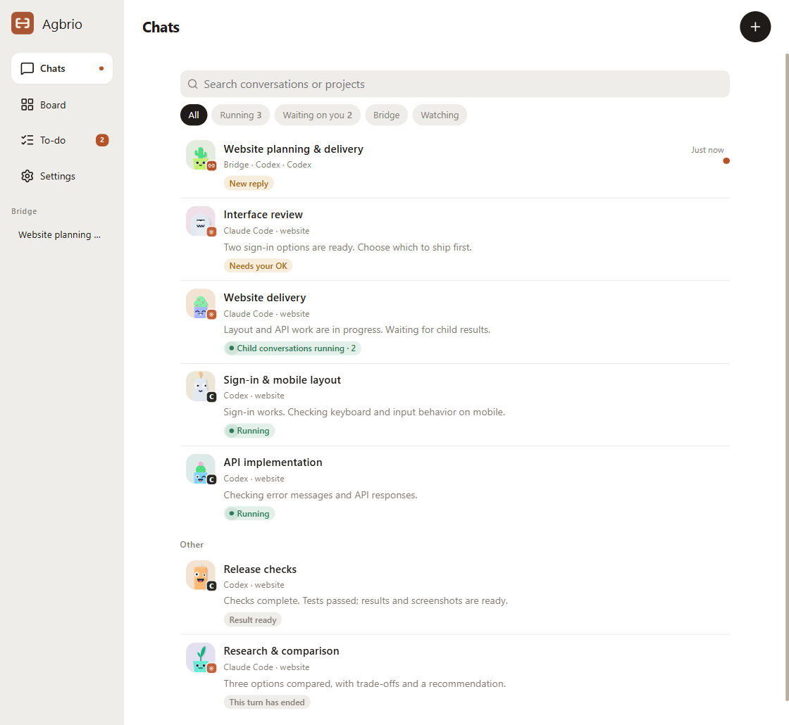
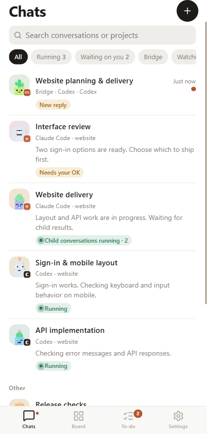
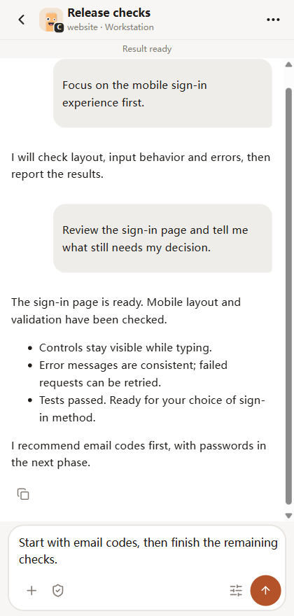
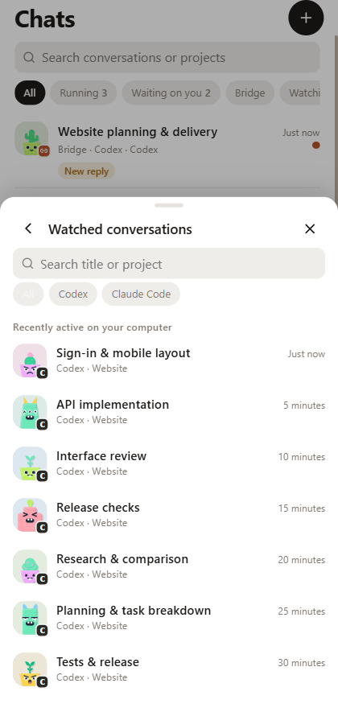
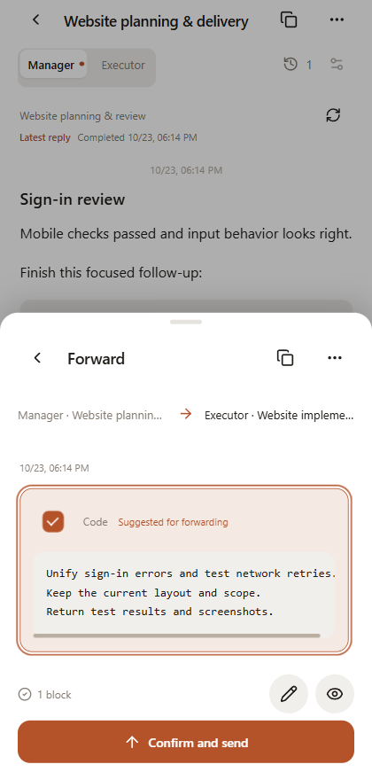
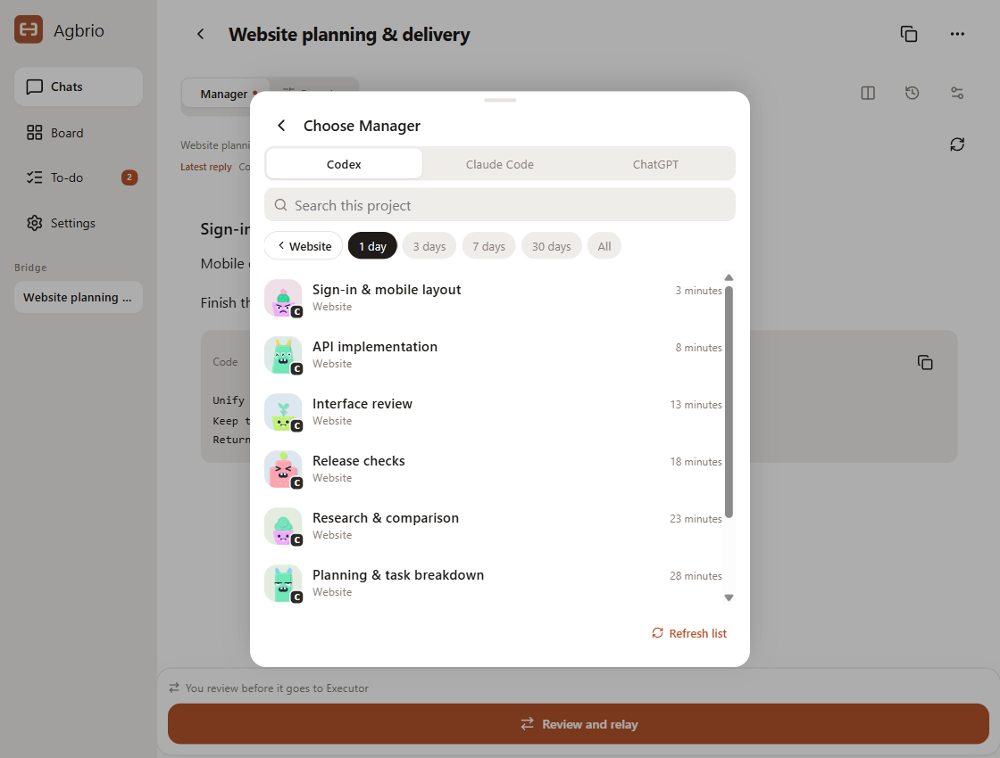
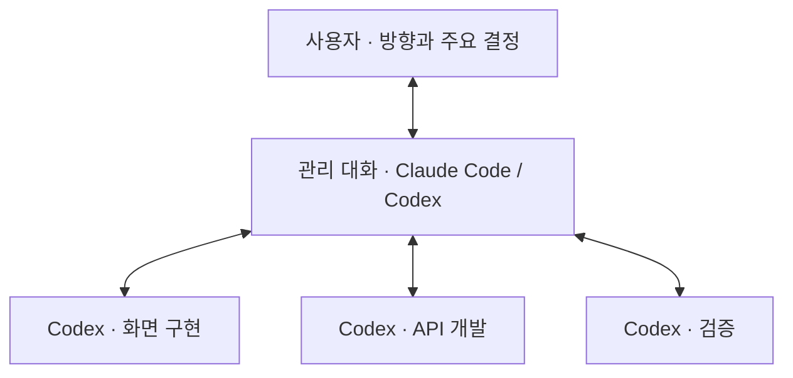

# Agbrio

**Agent는 PC에서 계속 일하고, 진행 상황은 휴대폰에서 확인하세요.**

[English](README.md) · [简体中文](README.zh-CN.md) · [繁體中文](README.zh-TW.md) · [日本語](README.ja.md) · [한국어](README.ko.md)

Codex와 Claude Code 대화를 확인하고, 메시지를 보내 후속 작업을 진행하세요. 새 결과나 결정이 필요할 때 알림을 받습니다. 계획과 실행을 나누거나 하나의 관리 대화에 여러 실행 대화를 맡길 수 있습니다.

## 자리를 비워도 진행 상황을 보고 답장하기

실행 중, 확인 대기, 하위 대화 상태를 한눈에 확인하세요. 원래 대화에서 결과를 읽고 추가 지시를 보내거나 지원되는 질문에 답할 수 있습니다.

 &nbsp; 

## 대화를 선택하고 지켜보거나 연결하기

PC의 기존 대화를 선택하세요. 하나를 모니터링하거나 관리자와 실행자를 Bridge로 연결할 수 있습니다. 전달할 내용과 대상을 확인한 뒤 직접 승인합니다.

 &nbsp; 

## 관리 대화에 일상적인 후속 작업 맡기기

하나의 관리 대화가 여러 Codex 대화의 진행 상황을 읽고, 작업을 전달하며, 결과를 정리합니다. 판단이 필요한 일은 사용자에게 돌아옵니다. Claude Code나 Codex를 관리 대화로 사용할 수 있습니다.

위임한 메시지는 Codex로 전송됩니다. Claude Code에는 휴대폰에서 직접 답장할 수 있습니다. 결정과 위임 범위는 사용자가 관리합니다.

## 시작하기

1. Windows 앱을 내려받고 사용 중인 Agent를 연결하세요.
2. 모니터링할 대화를 선택하거나 관리자와 실행자를 연결하세요.
3. 설정 → 기기에서 휴대폰을 페어링하고 Agbrio 주소를 여세요.

PC와 Agbrio는 온라인 상태여야 합니다. 알림을 받을 기기에서 알림을 켜세요.

[Download](https://github.com/geoffrey1111/agbrio/releases/latest) · [설정 안내](docs/START_HERE.md)

함께 쓰기 좋은 기능

대화에 연결된 문서, 이미지, 프로젝트 보드도 볼 수 있습니다. 맞춤 연동에는 API / MCP를 사용할 수 있습니다.

현재 인터페이스에 가상의 예시 데이터를 사용한 화면입니다.
