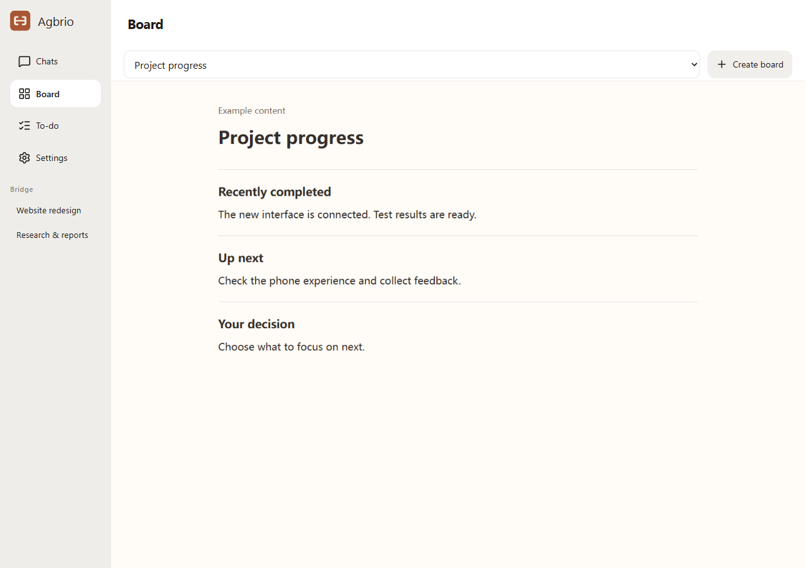
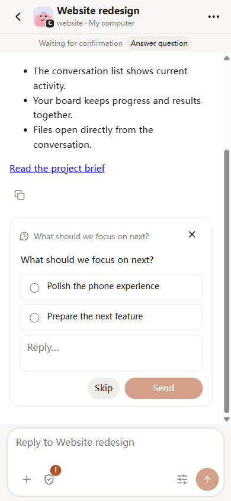
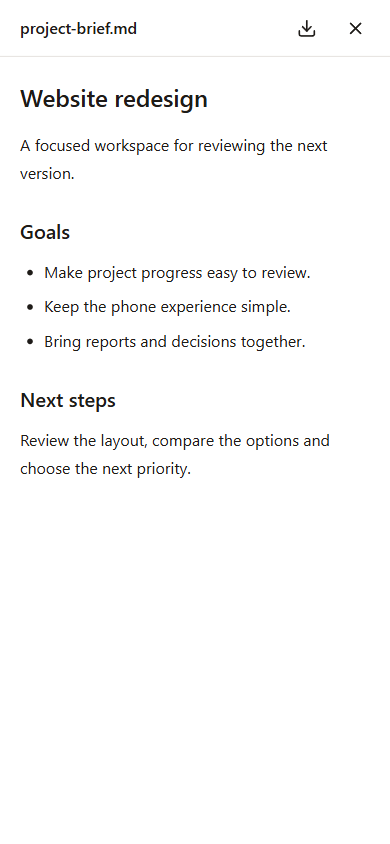
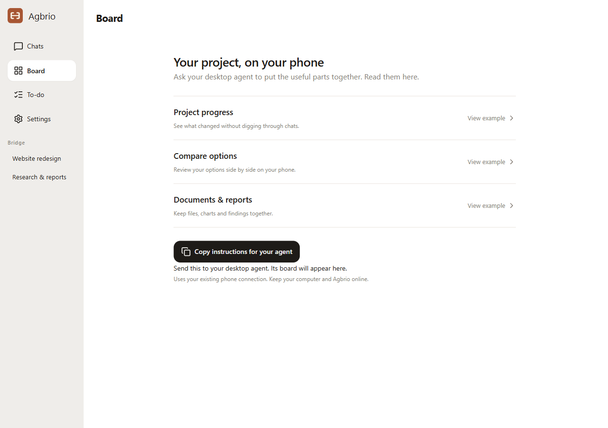

# Agbrio

**Keep up with your AI agents — from your desktop or phone.**

[English](README.md) · [简体中文](README.zh-CN.md) · [繁體中文](README.zh-TW.md) · [日本語](README.ja.md) · [한국어](README.ko.md)

Follow your Codex and Claude Code conversations, review their work, reply when needed, and keep project results on a board you can open anywhere.

## Your work, within reach

- **Stay in the conversation.** See current activity, read results and reply from your paired phone.
- **Make the next decision.** Answer supported questions and review child-conversation activity.
- **Hand over the useful part.** Select a result, check the destination and forward it to another conversation.
- **Open the files.** Read Markdown, images, code, JSON and CSV directly from a conversation.

 &nbsp; 

## Turn a project into a board

Ask your desktop agent to create a progress page, compare options or gather a report. Open **Board** (choose **Create board** if one is already connected), pick an example and copy the instructions to your agent. Its board appears in Agbrio and follows updates to the project files.

## Get started

1. **[Download Agbrio for Windows](https://github.com/geoffrey1111/agbrio/releases/latest)** and connect your existing agents.
2. **Choose a conversation or create a board.** Start with the work you already have.
3. **Pair your phone** in Settings → Devices. Use a hosted redemption code or your own HTTPS connection.

Keep your computer and Agbrio online for phone access.

[Setup & help](docs/START_HERE.md) · [Board guide](docs/BOARDS.md) · [Build from source](docs/BUILD.md)
