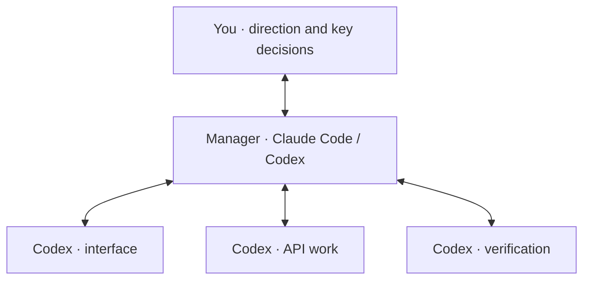

# Agbrio

**Your agents keep working. Stay in control from your phone.**

[English](README.md) · [简体中文](README.zh-CN.md) · [繁體中文](README.zh-TW.md) · [日本語](README.ja.md) · [한국어](README.ko.md)

Follow Codex and Claude Code conversations, reply with the next instruction, and get notified when something needs you. Pair planning with execution, or let one managing conversation coordinate several executors.

## Check progress. Reply from wherever you are.

See running work, pending decisions and child-conversation activity at a glance. Open the original conversation to read results, follow up or answer supported questions—without a remote desktop.

 &nbsp; 

## Choose conversations. Watch or connect them.

Pick existing conversations on your computer. Watch one to stay up to date, or bind a manager and executor as a Bridge. Select the content, check the destination and approve each handoff.

 &nbsp; 

## Let a managing conversation handle the follow-up.

Delegate progress checks, task messages and result summaries across several Codex conversations. Bring decisions back to you when needed. Your managing conversation can be in Claude Code or Codex.

Delegated sends target Codex. You can reply to Claude Code yourself from your phone. You keep control of decisions and delegated scope.

## Get started

1. Download the Windows app and connect the agent you already use.
2. Choose a conversation to watch, or connect a manager and executor.
3. Pair your phone in Settings → Devices, then open your Agbrio address.

Keep your computer and Agbrio online. Enable notifications on the receiving device.

[Download](https://github.com/geoffrey1111/agbrio/releases/latest) · [Setup guide](docs/START_HERE.md)

A few useful extras

Read linked documents, images and project boards in place. API / MCP is available when you need a custom integration.

Screenshots show the current interface with fictional example data.
