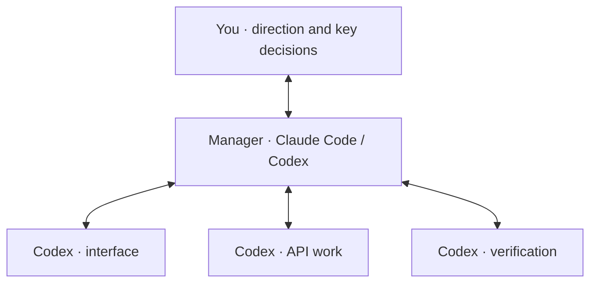

# Agbrio

Group work into management areas, change managers, and transfer executors in one place. Codex and Claude Code can both manage an area.

**Your agents keep working. Stay in control from your phone.**

**[Windows download](https://github.com/geoffrey1111/agbrio/releases/latest) · [macOS beta download (Apple Silicon)](https://github.com/geoffrey1111/agbrio/releases/tag/macos-beta-2026-11-05)**

[English](README.md) · [简体中文](README.zh-CN.md) · [繁體中文](README.zh-TW.md) · [日本語](README.ja.md) · [한국어](README.ko.md)

> Mac public beta: Apple Silicon only; not yet validated on a real Mac. [Limitations: Mac Beta](#mac-beta).

Follow Codex and Claude Code conversations, reply with the next instruction, and get notified when something needs you. Pair planning with execution, or let one managing conversation coordinate several executors.

## Check progress. Reply from wherever you are.

See running work, pending decisions and child-conversation activity at a glance. Open the original conversation to read results, follow up or answer supported questions—without a remote desktop.

 &nbsp; 

## Choose conversations. Watch or connect them.

Pick existing conversations on your computer. Watch one to stay up to date, or bind a manager and executor as a Bridge. Select the content, check the destination and approve each handoff.

 &nbsp; 

## Let a managing conversation handle the follow-up.

Delegate progress checks, task messages and result summaries across several Codex conversations. Bring decisions back to you when needed. Your managing conversation can be in Claude Code or Codex.

Delegated sends target Codex. You can reply to Claude Code yourself from your phone. You keep control of decisions and delegated scope.

## Get started

1. Download and open the Windows app. Choose Codex, Claude Code, or both.
2. Follow the first-run guide to connect your agents, authorize access and pair your phone.
3. Choose a conversation and follow up from your phone. Skip setup whenever you want, or reopen it from Settings.

Keep your computer and Agbrio online. Enable notifications on the receiving device.

[Download](https://github.com/geoffrey1111/agbrio/releases/latest) · [Setup guide](docs/START_HERE.md)

A few useful extras

Read linked documents, images and project boards in place. API / MCP is available when you need a custom integration.

Screenshots show the current interface with fictional example data.

## Mac Beta

**Mac public beta — Apple Silicon (ARM64) only. Not formal macOS support. External testers have not yet validated it on their own Macs; problems may exist.** Intel Macs are unsupported. macOS 13.5 is the declared minimum, not a verified OS/model matrix. GitHub Mac CI is engineering evidence, not user UAT or Windows feature parity. General feature descriptions above primarily describe Windows; these beta limits govern Mac.

[Mac beta Release](https://github.com/geoffrey1111/agbrio/releases/tag/macos-beta-2026-11-05) · [DMG](https://github.com/geoffrey1111/agbrio/releases/download/macos-beta-2026-11-05/Agbrio_0.1.0_aarch64.dmg) · [SHA-256](https://github.com/geoffrey1111/agbrio/releases/download/macos-beta-2026-11-05/SHA256SUMS.txt) · [Report a problem](https://github.com/geoffrey1111/agbrio/issues/new)

### First open and personal approvals

This is an unsigned test distribution in Apple's identified-developer sense: **ad-hoc signature only, no Developer ID signature or notarization**.

1. Download the DMG and `SHA256SUMS.txt` from this Release. Compare the full DMG SHA-256 using macOS `shasum -a 256` before opening.
2. Copy `Agbrio.app` from the DMG to Applications or your own `~/Applications`, eject the DMG, and try opening the copied app in Finder.
3. If blocked and you trust this download, use **System Settings → Privacy & Security → Open Anyway**, then confirm **Open** yourself. [Apple instructions](https://support.apple.com/en-us/102445). Stop on malware alerts or checksum mismatch.
4. First launch, notification, selected-file and login-item permissions must be handled by you. Your Codex/agent must not approve security prompts. Agbrio does not automatically remove quarantine or change system trust.

Email passwords and MCP Events keys use your current-user Keychain. Ad-hoc upgrades may prompt again: only if you trust this build, choose **Allow / Always Allow** yourself. Refusal/incomplete prompts can leave those features unavailable. No Keychain ACL migration. Real accounts, system prompts, phone end-to-end use and long-term operation remain unverified.

### Unavailable in this beta

- **Pi:** no Mac entry, tasks or bundled `pi-adapter` resources.
- **Shared Codex:** production prepare/activate/close is unsupported. Internal app-server fixtures do not prove actual Codex Desktop compatibility. Other CLI/account integrations also need testing with your own installation/account. No OpenAI installer, SDK or profile is bundled or redistributed.
- **In-app updates:** unavailable. Manually download each new Mac version, verify its checksum, quit Agbrio normally, then replace the app. Preserve application data, pairing and history; do not copy Windows credentials/profiles. Mac is not added to the updater manifest.
- **Hosted trial/redemption:** this Mac distribution does not configure a hosted-service entrance, so these controls are unavailable; trial device identity is also Windows-only. A code cannot activate hosted phone connectivity in this beta. Do not purchase/redeem a code for that purpose. Codes are not Codex/Claude subscriptions. Local/self-hosted settings are separate candidates and still need real-Mac/phone validation.

Use only your own Mac/accounts. At [Issues](https://github.com/geoffrey1111/agbrio/issues/new), include chip/model, macOS, Release tag, reproduction steps and relevant screenshots/logs. First redact personal paths, accounts, keys/tokens and conversations; never upload credentials, profiles or conversation databases. Windows downloads/updates still use the existing [Windows Latest](https://github.com/geoffrey1111/agbrio/releases/latest).
