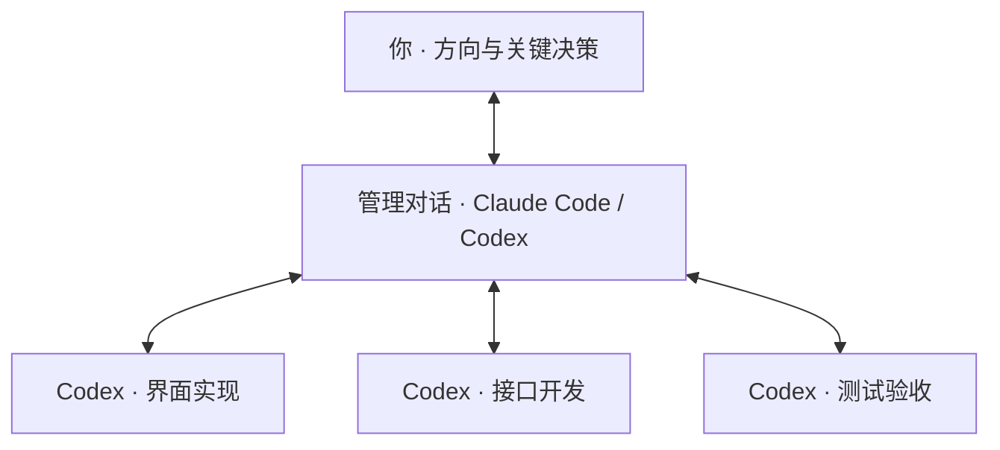

# Agbrio

**电脑上的 Agent 继续工作，你在手机上掌握进展。**

**[Windows 下载](https://github.com/geoffrey1111/agbrio/releases/latest) · [macOS 测试版下载（Apple Silicon）](https://github.com/geoffrey1111/agbrio/releases/tag/macos-beta-2026-11-05)**

[English](README.md) · [简体中文](README.zh-CN.md) · [繁體中文](README.zh-TW.md) · [日本語](README.ja.md) · [한국어](README.ko.md)

> Mac 公开测试版：仅 Apple Silicon，未经真机验证。[限制见 Mac Beta 一节](#mac-beta)。

查看 Codex、Claude Code 对话，发消息跟进，接收新回复和待处理通知。把管理与执行分工，也可以让一个管理对话协调多个执行对话。

## 离开电脑，也能看进度、回消息

一眼看到执行中、等待确认和子对话状态。点进原对话查看成果、补充要求、回答支持的提问，不用远程控制整个桌面。

 &nbsp; 

## 选择对话，开始监听或绑定协作

从电脑上已有的对话中选择。监听一个对话，随时跟进；把规划与执行连成 Bridge，选择要转交的内容，确认目标后由你批准发送。

 &nbsp; 

## 把日常跟进交给管理对话

授权一个管理对话协调多个 Codex 执行对话：读取进展、传递任务、汇总结果；遇到需要你决定的事项，再交给你。管理对话可以来自 Claude Code，也可以来自 Codex。

管理委派支持向 Codex 发送；Claude Code 对话支持你本人从手机回复。关键决策和授权范围始终由你掌握。

## 开始使用

1. 下载 Windows 版，连接你正在使用的 Agent。
2. 选择对话开始监听，或绑定管理端与执行端。
3. 在「设置 → 设备」配对手机，打开你的 Agbrio 地址。

手机访问时，电脑与 Agbrio 需要保持在线；通知需在设备上启用。

[Download](https://github.com/geoffrey1111/agbrio/releases/latest) · [使用帮助](docs/START_HERE.md)

还有这些顺手的功能

直接阅读对话中的文档、图片与项目看板。需要自定义集成时，再使用 API / MCP。

所有截图均为当前界面，使用虚构示例数据。

## Mac Beta

**Mac 公开测试版，仅 Apple Silicon（ARM64）；不是正式 macOS 支持。尚未经外部测试者自有 Mac 真机验证，可能有问题。** 不支持 Intel Mac。macOS 13.5 只是声明的最低版本，系统／机型验证尚未完成。GitHub Mac CI 是工程验证，不代表真机 UAT 或与 Windows 功能对齐。上方通用功能介绍主要描述 Windows；Mac 以本节限制为准。

[Mac 测试版 Release](https://github.com/geoffrey1111/agbrio/releases/tag/macos-beta-2026-11-05) · [DMG 下载](https://github.com/geoffrey1111/agbrio/releases/download/macos-beta-2026-11-05/Agbrio_0.1.0_aarch64.dmg) · [SHA-256 校验和](https://github.com/geoffrey1111/agbrio/releases/download/macos-beta-2026-11-05/SHA256SUMS.txt) · [问题反馈](https://github.com/geoffrey1111/agbrio/issues/new)

### 未签名测试 app 首次打开与本人授权

本包只有 **ad-hoc 签名，没有 Apple Developer ID 签名或公证**。

1. 下载该 Release 的 DMG 和 `SHA256SUMS.txt`，用 macOS `shasum -a 256` 比较完整 SHA-256，一致后再打开。
2. 将 DMG 中的 `Agbrio.app` 复制到 Applications 或自己的 `~/Applications`，推出 DMG，再从 Finder 尝试打开复制后的 app。
3. 若被拦截且你信任此下载，到**系统设置 → 隐私与安全性 → 仍要打开**，由本人确认「打开」。[Apple 官方步骤](https://support.apple.com/en-us/102445)。恶意软件警告或校验和不一致时应停止并反馈。
4. 首次启动、通知、所选文件和登录项等系统权限由本人决定与操作，Codex／Agent 不应代点。应用不会自动移除 quarantine 或更改系统信任。

邮箱密码与 MCP Events 密钥使用当前用户钥匙串。ad-hoc 升级后可能再次提示；只有信任此版本时才由本人选择「允许／始终允许」。拒绝或未完成提示时相关功能可能不可用。不做 Keychain ACL 迁移。真实账号、权限弹窗、手机端到端与长期运行仍未验证。

### 本测试版不可用

- **Pi：**没有 Mac Pi 入口、任务或 `pi-adapter` 打包资源。
- **共享 Codex：**正式准备／激活／关闭仍不支持。内部 app-server 模拟测试不证明真实 Codex Desktop 兼容；其他 CLI／账号集成也需用自己的安装和账号验证。不打包或分发 OpenAI 安装包、SDK 或 profile。
- **应用内更新：**不可用。每次新版本需手动下载、核对校验和，正常退出 Agbrio 后替换 app。保留应用数据、配对和历史，不复制 Windows 凭据／profile；本次不在更新清单加入 Mac。
- **托管试用／兑换：**本次 Mac 包未配置托管服务入口，试用与兑换控件不可用；稳定试用设备身份也仍仅适配 Windows。兑换码不能为本测试版开通托管手机连接，请勿为此用途购买或兑换。兑换码不是 Codex／Claude 订阅。本地／自托管设置是独立候选能力，仍需真实 Mac 和手机验证。

测试者只使用自己的 Mac 和账号。在 [Issues](https://github.com/geoffrey1111/agbrio/issues/new) 提供芯片／机型、macOS、Release 标签、复现步骤和相关截图／日志；提交前遮盖个人路径、账号、密钥／token、对话内容，不上传凭据、profile 或对话数据库。Windows 下载与更新仍使用原 [Windows Latest](https://github.com/geoffrey1111/agbrio/releases/latest)。
