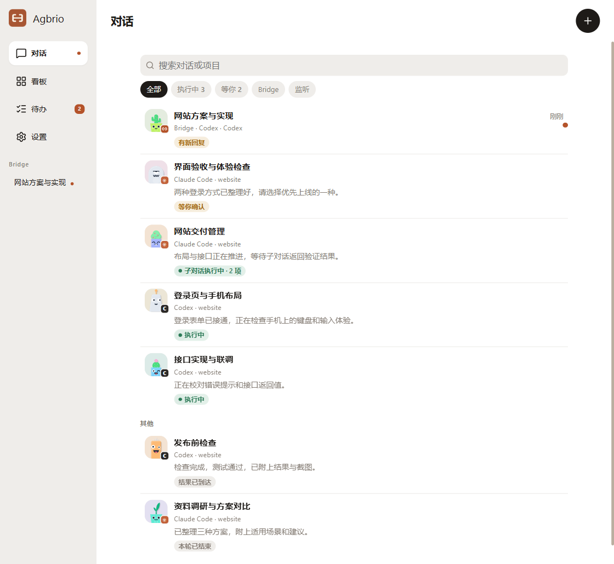
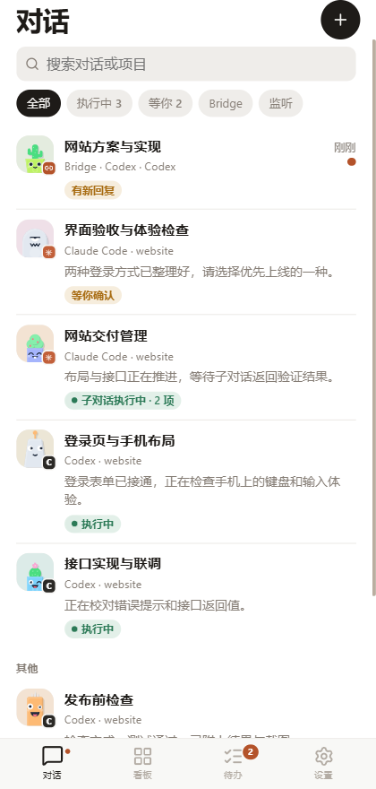
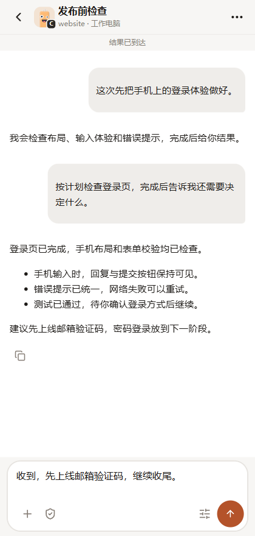
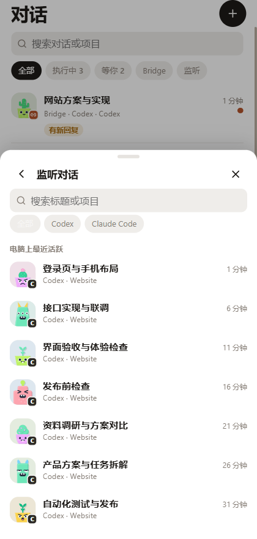
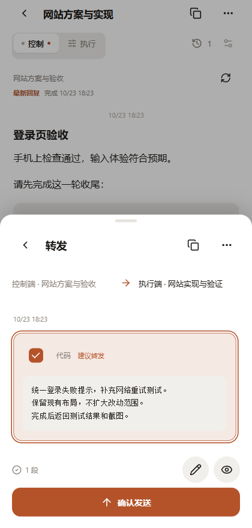
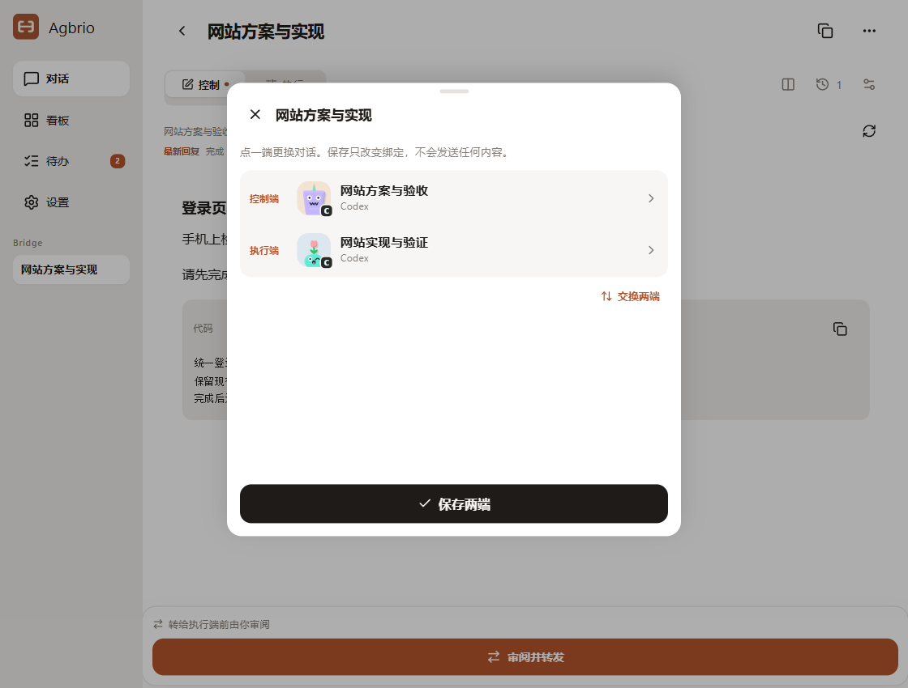
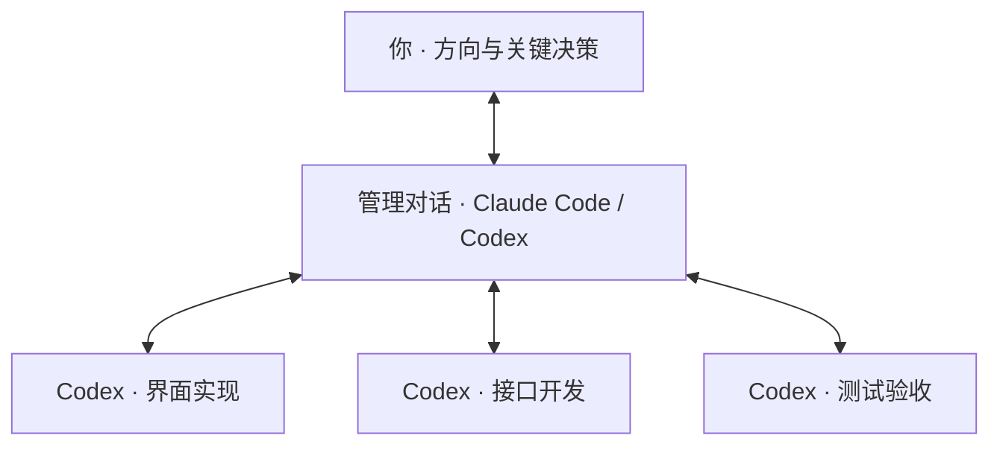

# Agbrio

**电脑上的 Agent 继续工作，你在手机上掌握进展。**

[English](README.md) · [简体中文](README.zh-CN.md) · [繁體中文](README.zh-TW.md) · [日本語](README.ja.md) · [한국어](README.ko.md)

查看 Codex、Claude Code 对话，发消息跟进，接收新回复和待处理通知。把管理与执行分工，也可以让一个管理对话协调多个执行对话。

## 离开电脑，也能看进度、回消息

一眼看到执行中、等待确认和子对话状态。点进原对话查看成果、补充要求、回答支持的提问，不用远程控制整个桌面。

 &nbsp; 

## 选择对话，开始监听或绑定协作

从电脑上已有的对话中选择。监听一个对话，随时跟进；把规划与执行连成 Bridge，选择要转交的内容，确认目标后由你批准发送。

 &nbsp; 

## 把日常跟进交给管理对话

授权一个管理对话协调多个 Codex 执行对话：读取进展、传递任务、汇总结果；遇到需要你决定的事项，再交给你。管理对话可以来自 Claude Code，也可以来自 Codex。

管理委派支持向 Codex 发送；Claude Code 对话支持你本人从手机回复。关键决策和授权范围始终由你掌握。

## 开始使用

1. 下载 Windows 版，连接你正在使用的 Agent。
2. 选择对话开始监听，或绑定管理端与执行端。
3. 在「设置 → 设备」配对手机，打开你的 Agbrio 地址。

手机访问时，电脑与 Agbrio 需要保持在线；通知需在设备上启用。

[Download](https://github.com/geoffrey1111/agbrio/releases/latest) · [使用帮助](docs/START_HERE.md)

还有这些顺手的功能

直接阅读对话中的文档、图片与项目看板。需要自定义集成时，再使用 API / MCP。

所有截图均为当前界面，使用虚构示例数据。
