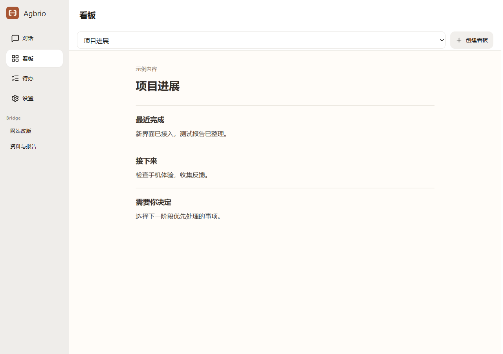
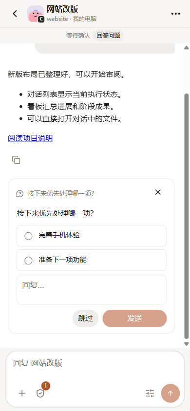
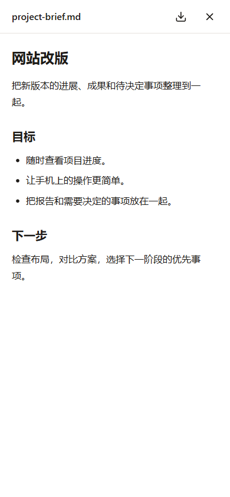
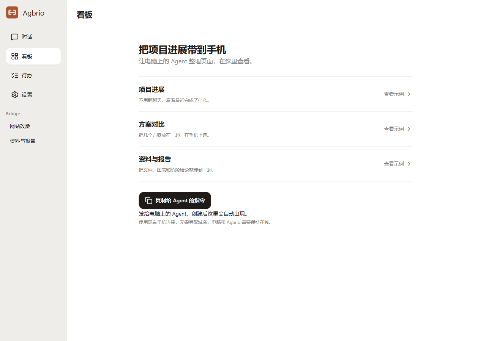

# Agbrio

**電腦上的 Agent 在推進，手機上的你隨時跟進。**

[English](README.md) · [简体中文](README.zh-CN.md) · [繁體中文](README.zh-TW.md) · [日本語](README.ja.md) · [한국어](README.ko.md)

把 Codex、Claude Code 的對話和項目看板放在一起。查看進展、閱讀成果、回覆消息，需要你決定時及時處理。

## 離開電腦，也能接着工作

- **跟進對話**：查看執行状態和最新回覆，在手機上回覆原對話。
- **處理問题**：回答支持的提問與選項，查看子對話的工作状態。
- **轉交成果**：選擇有用的内容，確认目标後轉給另一条對話。
- **直接讀文件**：在對話里打開 Markdown、圖片、代碼、JSON 和 CSV。

 &nbsp; 

## 讓 Agent 把成果整理成看板

項目進展、方案對比、資料報告，都可以變成手機上的一個頁面。打開 **看板**（已有看板時點 **創建看板**），選一個示例，把指令發給電腦上的 Agent。創建完成後，看板會出現在 Agbrio，跟隨項目文件更新。

## 開始使用

1. **[下载 Windows 版](https://github.com/geoffrey1111/agbrio/releases/latest)**，連接正在使用的 Agent。
2. **選擇對話，或創建看板**，從手頭的項目開始。
3. **在 設置 → 設備 配對手機**，使用托管兌換碼或自己的 HTTPS 連接。

手機访問時，電腦和 Agbrio 需要保持在線。

[使用幫助](docs/START_HERE.md) · [看板指南](docs/BOARDS.md) · [源碼構建](docs/BUILD.md)
