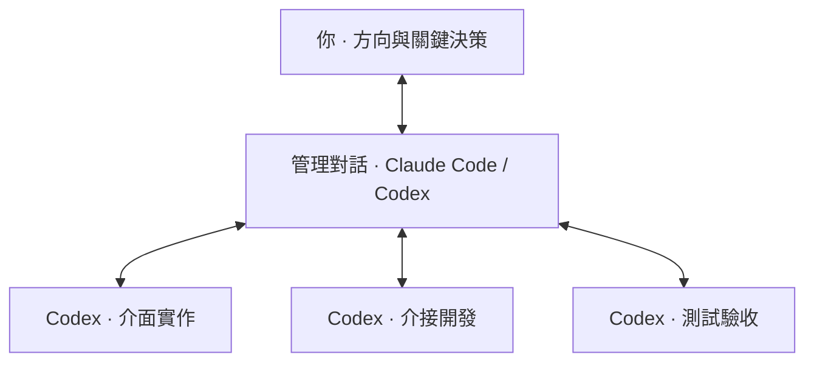

# Agbrio

**電腦上的 Agent 繼續工作，你在手機上掌握進展。**

[English](README.md) · [简体中文](README.zh-CN.md) · [繁體中文](README.zh-TW.md) · [日本語](README.ja.md) · [한국어](README.ko.md)

查看 Codex、Claude Code 對話，傳送訊息跟進，接收新回覆與待處理通知。讓管理與執行分工，也能由一個管理對話協調多個執行對話。

## 離開電腦，也能看進度、回訊息

一眼看到執行中、等待確認與子對話狀態。進入原對話查看成果、補充要求、回答支援的提問，不用遠端控制整個桌面。

 &nbsp; 

## 選擇對話，開始監聽或綁定協作

從電腦上已有的對話中選擇。監聽單一對話，隨時跟進；把規劃與執行連成 Bridge，選擇轉交內容並確認對象，由你批准傳送。

 &nbsp; 

## 把日常跟進交給管理對話

授權一個管理對話協調多個 Codex 執行對話：讀取進展、傳遞任務、彙整結果；需要你決定時，再交回給你。管理對話可來自 Claude Code 或 Codex。

管理委派支援向 Codex 傳送；Claude Code 對話支援你本人從手機回覆。關鍵決策與授權範圍始終由你掌握。

## 開始使用

1. 下載 Windows 版，連接你正在使用的 Agent。
2. 選擇對話開始監聽，或綁定管理端與執行端。
3. 在「設定 → 裝置」配對手機，開啟你的 Agbrio 網址。

手機存取時，電腦與 Agbrio 需要保持上線；請在接收裝置啟用通知。

[Download](https://github.com/geoffrey1111/agbrio/releases/latest) · [使用說明](docs/START_HERE.md)

也有這些實用功能

直接閱讀對話中的文件、圖片與專案看板。需要自訂整合時，再使用 API / MCP。

截圖為目前介面，使用虛構示例資料。
