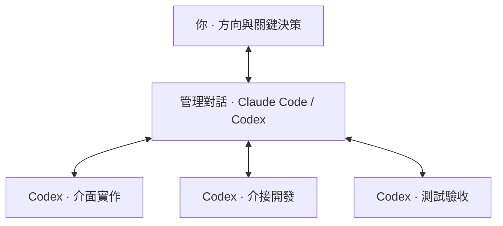

# Agbrio

**電腦上的 Agent 繼續工作，你在手機上掌握進展。**

**[Windows 下載](https://github.com/geoffrey1111/agbrio/releases/latest) · [macOS 測試版下載（Apple Silicon）](https://github.com/geoffrey1111/agbrio/releases/tag/macos-beta-2026-11-05-rc122-sync)**

[English](README.md) · [简体中文](README.zh-CN.md) · [繁體中文](README.zh-TW.md) · [日本語](README.ja.md) · [한국어](README.ko.md)

> Mac 公開測試版：僅 Apple Silicon，未經實機驗證。[限制請見 Mac Beta 一節](#mac-beta)。

查看 Codex、Claude Code 對話，傳送訊息跟進，接收新回覆與待處理通知。讓管理與執行分工，也能由一個管理對話協調多個執行對話。

## 離開電腦，也能看進度、回訊息

一眼看到執行中、等待確認與子對話狀態。進入原對話查看成果、補充要求、回答支援的提問，不用遠端控制整個桌面。

 &nbsp; 

## 選擇對話，開始監聽或綁定協作

從電腦上已有的對話中選擇。監聽單一對話，隨時跟進；把規劃與執行連成 Bridge，選擇轉交內容並確認對象，由你批准傳送。

 &nbsp; 

## 把日常跟進交給管理對話

授權一個管理對話協調多個 Codex 執行對話：讀取進展、傳遞任務、彙整結果；需要你決定時，再交回給你。管理對話可來自 Claude Code 或 Codex。

管理委派支援向 Codex 傳送；Claude Code 對話支援你本人從手機回覆。關鍵決策與授權範圍始終由你掌握。

## 開始使用

1. 下載 Windows 版，連接你正在使用的 Agent。
2. 選擇對話開始監聽，或綁定管理端與執行端。
3. 在「設定 → 裝置」配對手機，開啟你的 Agbrio 網址。

手機存取時，電腦與 Agbrio 需要保持上線；請在接收裝置啟用通知。

[Download](https://github.com/geoffrey1111/agbrio/releases/latest) · [使用說明](docs/START_HERE.md)

也有這些實用功能

直接閱讀對話中的文件、圖片與專案看板。需要自訂整合時，再使用 API / MCP。

截圖為目前介面，使用虛構示例資料。

## Mac Beta

本測試版同步 Windows rc.122 的管理區、星圖與首次引導；Mac 仍不提供 Pi、共享 Codex 與應用程式內更新。首次引導跳過 Mac 無法使用的共享 Codex；Claude MCP 在原 Code 對話中手動接入。

**Mac 公開測試版，僅 Apple Silicon（ARM64）；並非正式 macOS 支援。尚未由外部測試者以自有 Mac 實機驗證，可能有問題。** 不支援 Intel Mac。macOS 13.5 僅是宣告的最低版本，系統／機型驗證未完成。GitHub Mac CI 是工程驗證，不代表實機 UAT 或 Windows 功能對齊。上方介紹主要描述 Windows；Mac 以本節限制為準。

[Mac 測試版 Release](https://github.com/geoffrey1111/agbrio/releases/tag/macos-beta-2026-11-05-rc122-sync) · [DMG 下載](https://github.com/geoffrey1111/agbrio/releases/download/macos-beta-2026-11-05-rc122-sync/Agbrio_0.1.0_aarch64.dmg) · [SHA-256](https://github.com/geoffrey1111/agbrio/releases/download/macos-beta-2026-11-05-rc122-sync/SHA256SUMS.txt) · [問題回報](https://github.com/geoffrey1111/agbrio/issues/new)

### 未簽署測試 app 首次開啟與本人授權

僅有 **ad-hoc 簽署，沒有 Apple Developer ID 簽署或公證**。

1. 下載此 Release 的 DMG 與 `SHA256SUMS.txt`，用 macOS `shasum -a 256` 比對完整 SHA-256，相符後才開啟。
2. 將 DMG 中的 `Agbrio.app` 複製至 Applications 或自己的 `~/Applications`，退出 DMG，再從 Finder 嘗試開啟。
3. 若遭阻擋且你信任此下載，前往**系統設定 → 隱私權與安全性 → 強制打開**，由本人確認「打開」。[Apple 官方步驟](https://support.apple.com/en-us/102445)。惡意軟體警告或校驗和不符時請停止並回報。
4. 首次啟動、通知、所選檔案和登入項目的系統權限由本人決定，Codex／Agent 不應代為確認。程式不自動移除 quarantine 或變更系統信任。

電子郵件密碼與 MCP Events 金鑰使用目前使用者鑰匙圈。ad-hoc 升級可能再次提示；僅在信任此版本時由本人選「允許／永遠允許」。拒絕或未完成提示可能使功能無法使用；不遷移 Keychain ACL。真實帳號、權限提示、手機端到端與長期執行未驗證。

### 本測試版無法使用

- **Pi：**沒有 Mac Pi 入口、任務或 `pi-adapter` 資源。
- **共用 Codex：**正式準備／啟用／關閉未支援；內部 app-server 模擬不證明真實 Codex Desktop 相容。其他 CLI／帳號整合也需自己的安裝與帳號驗證。不散布 OpenAI 安裝程式、SDK 或 profile。
- **應用程式內更新：**無法使用。新版本須手動下載、核對校驗和，正常結束 Agbrio 再替換 app。保留資料、配對及歷程，不複製 Windows 憑據／profile；本次不將 Mac 加入更新清單。
- **託管手機連線、試用與啟用碼：**本測試版已啟用。Mac CI 以未改動的測試服務 Worker、真實 TLS/WSS、隨包 Node connector 與瀏覽器驗證兌換、試用啟用、續期、配對及模擬提供方訊息回環。試用資格僅使用 IOPlatformUUID 的用途限定雜湊；不儲存或傳送原始 UUID，讀取失敗明確報錯，不以隨機值替代。線上真實帳號／租約、真實 Mac 與手機仍未驗證。啟用碼用於託管連線，不是 Codex／Claude 訂閱。

僅使用自己的 Mac 和帳號。於 [Issues](https://github.com/geoffrey1111/agbrio/issues/new) 提供晶片／機型、macOS、Release 標籤、重現步驟及圖片／記錄。先遮蔽個人路徑、帳號、金鑰／token 與對話，不上傳憑據、profile、對話資料庫。Windows 下載／更新仍用原 [Windows Latest](https://github.com/geoffrey1111/agbrio/releases/latest)。
