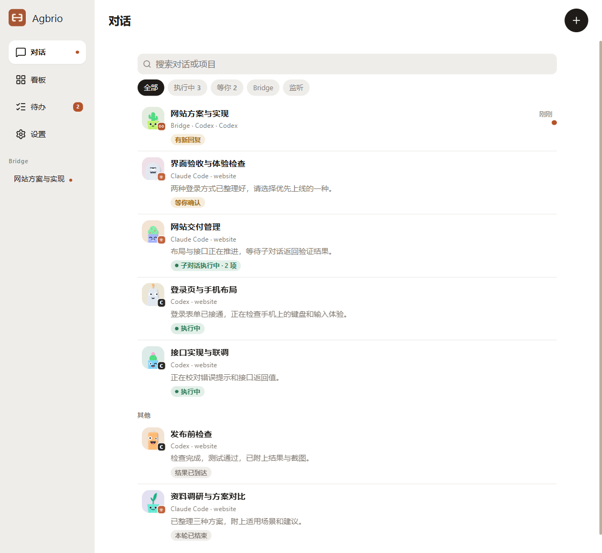
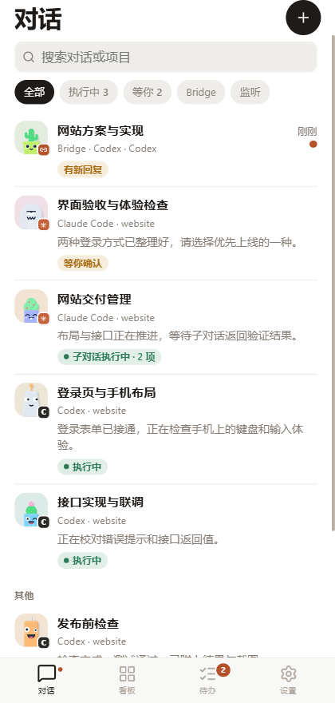
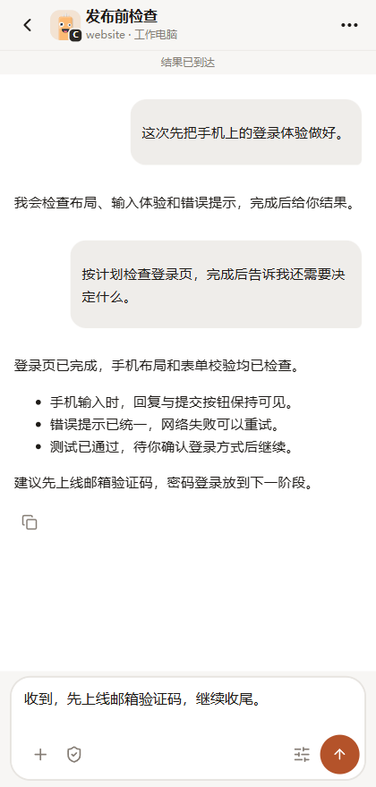
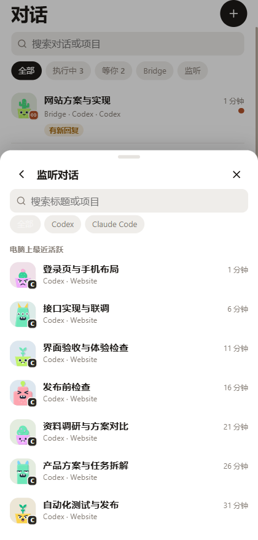
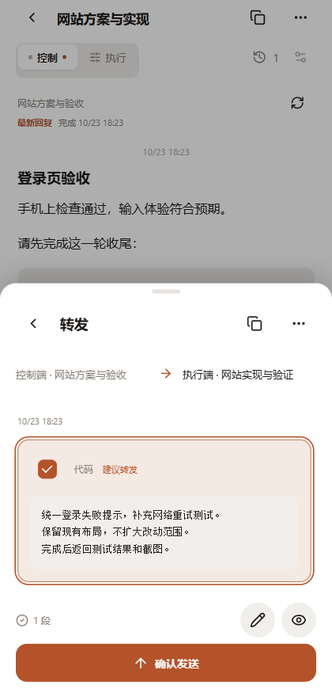
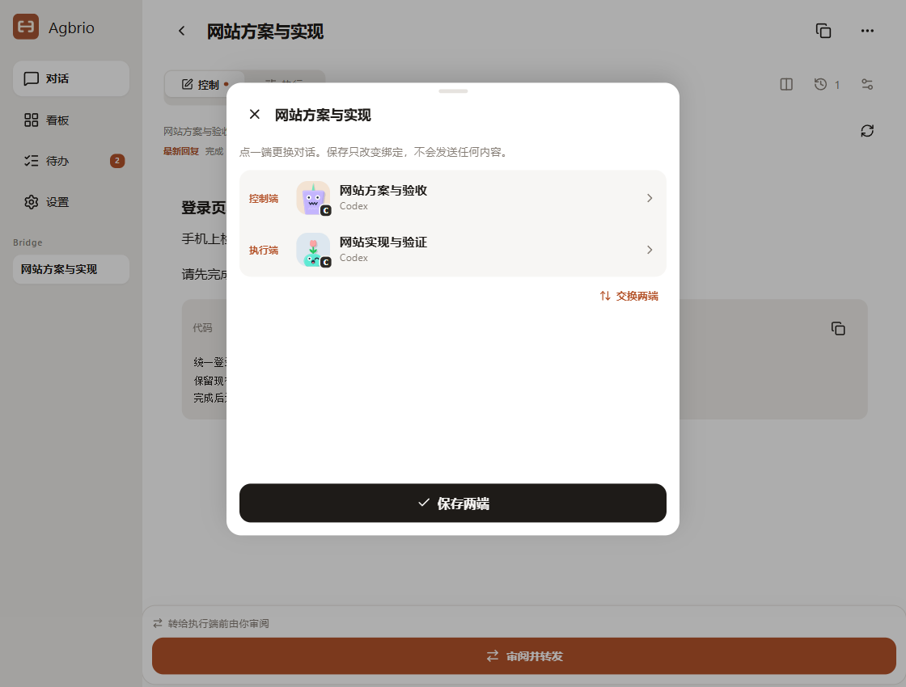
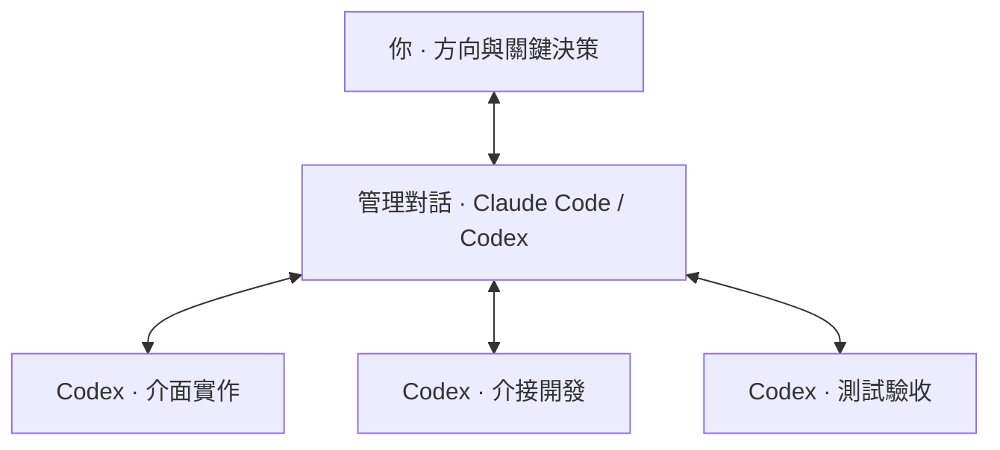

# Agbrio

**電腦上的 Agent 繼續工作，你在手機上掌握進展。**

[](https://github.com/geoffrey1111/agbrio/releases/latest)
[](https://github.com/geoffrey1111/agbrio/actions/workflows/windows-alpha.yml)
[](LICENSE)
[](https://github.com/geoffrey1111/agbrio/releases/latest)

[English](README.md) · [简体中文](README.zh-CN.md) · [繁體中文](README.zh-TW.md) · [日本語](README.ja.md) · [한국어](README.ko.md)

查看 Codex、Claude Code 對話，傳送訊息跟進，接收新回覆與待處理通知。讓管理與執行分工，也能由一個管理對話協調多個執行對話。



## 離開電腦，也能看進度、回訊息

一眼看到執行中、等待確認與子對話狀態。進入原對話查看成果、補充要求、回答支援的提問，不用遠端控制整個桌面。

<p align="center"> &nbsp; </p>

## 選擇對話，開始監聽或綁定協作

從電腦上已有的對話中選擇。監聽單一對話，隨時跟進；把規劃與執行連成 Bridge，選擇轉交內容並確認對象，由你批准傳送。

<p align="center"> &nbsp; </p>



## 把日常跟進交給管理對話

授權一個管理對話協調多個 Codex 執行對話：讀取進展、傳遞任務、彙整結果；需要你決定時，再交回給你。管理對話可來自 Claude Code 或 Codex。



管理委派支援向 Codex 傳送；Claude Code 對話支援你本人從手機回覆。關鍵決策與授權範圍始終由你掌握。

## 開始使用

1. 下載 Windows 版，連接你正在使用的 Agent。
2. 選擇對話開始監聽，或綁定管理端與執行端。
3. 在「設定 → 裝置」配對手機，開啟你的 Agbrio 網址。

手機存取時，電腦與 Agbrio 需要保持上線；請在接收裝置啟用通知。

[Download](https://github.com/geoffrey1111/agbrio/releases/latest) · [使用說明](docs/START_HERE.md)

<details>
<summary>也有這些實用功能</summary>

直接閱讀對話中的文件、圖片與專案看板。需要自訂整合時，再使用 API / MCP。

</details>

<sub>截圖為目前介面，使用虛構示例資料。</sub>


## macOS 預覽候選（Apple Silicon）

macOS 適配仍在進行，尚未與 Windows 功能對齊。手動 **macOS candidate DMG** Actions 產生 ad-hoc 簽名 `.dmg` artifact，不建立 Release、不使用更新簽名 secret。ARM64 原始碼測試及較早候選 DMG 的交付副本啟動已在 GitHub macOS 26.6.2 通過。macOS 13.5 是宣告的部署目標，尚未在該系統版本驗證。

原生路徑、本機維護 CLI、Claude 引擎探索、通知整合、選單列/Dock、登入啟動設定、資源採樣、限定使用者服務復原、固定版本隨需 Chromium 已有 Mac 實作與自動化測試。實際帳號、系統權限提示、通知點擊、手機端到端與長期執行仍待驗證。共享 Codex 已有依 app-server 協定撰寫的準備/啟用/關閉內部候選及模擬測試；正式 Mac 入口在階段4雲 Mac 實包驗證前維持不支援。儲存庫/CI 不再下載或散布 OpenAI 安裝包。Pi 提權/工作區授權、Keychain 秘密、裝置試用身分、輔助使用和簽名應用程式內更新需要後續安全設計批准。已退役的瀏覽器連接器/Native Messaging 維持退役。

核對 artifact 校驗和後，將 `Agbrio.app` 放入 Applications。本人信任的 ad-hoc 候選若被攔截，可至**系統設定 → 隱私權與安全性 → 強制打開**，或由本人執行以下命令。應用程式不會自動移除 quarantine。無需 Apple Developer 帳號；候選沒有 Developer ID 簽名或公證。

```text
xattr -dr com.apple.quarantine /Applications/Agbrio.app
```

通知權限只由明確的桌面操作申請。所選檔案、可移除磁碟區或受保護位置可能需要本人授予檔案與檔案夾或完整磁碟存取權限。未來唯讀 AX 功能才需輔助使用權限。ad-hoc 身分隨每次建置變更，更新後系統可能要求重新授權。CI 通過是自動化工程證據，不代表使用者 UAT 或完整功能對齊。
