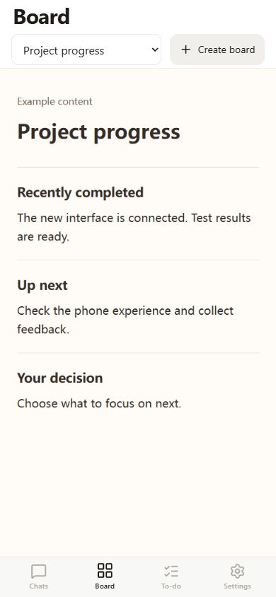

# Your project board

A board gives your project a page you can revisit on your phone: progress, results, screenshots, comparisons or a report.

1. Open **Board**. If a board is already connected, choose **Create board**.
2. View an example and **copy the instructions for your agent**.
3. Send them to the agent working on your computer. Tell it what you want to see.
4. Open the new board in Agbrio. Ask the agent to update the same folder when the project changes.

The board uses your existing phone connection. A hosted activation already provides your private entrance; you do not need another domain or tunnel. Your computer and Agbrio must stay online. Expiry or revocation stops hosted access and retains the local project files.

You can keep multiple published boards and switch between them. Your previously connected website or local board stays available. Existing website boards keep their own login and interaction behavior.



<details>
<summary>For desktop agents and developers</summary>

Create a dedicated folder and an explicit file manifest named agbrio-board.json:

```json
{"schemaVersion":1,"title":"Project progress","entry":"index.html","files":["index.html","plot.png","data.json"]}
```

Discover `boards.cliPath` with `agbrio_capabilities`, or use the installed application's `app-control/control.ps1`:

```powershell
pwsh -NoProfile -File '<Agbrio>/app-control/control.ps1' -Command PublishBoard -Folder '<absolute-board-folder>'
```

Use the returned board identity and revision to check publication. Registration is idempotent for the same canonical folder. Later file edits are picked up by the reader; do not repeatedly publish to trigger a refresh. After an uncertain CLI reply inspect the original registration rather than blindly retrying.

Include only presentation material you intend to share with the paired devices. The manifest is an explicit allowlist, not permission to publish the entire project. Exclude credentials, transcripts and unrelated files.

Supported content: HTML, CSS, JavaScript, JSON, Markdown, text, CSV, PNG, JPEG, GIF and WebP. Entry must be index.html. Up to256 files,8MiB per file,32MiB total; combined entry/styles/scripts up to1MiB. Use relative paths inside the folder. External scripts/CDNs, network requests, frames, native APIs, form submissions and cross-page navigation are blocked. Classic local scripts/styles are inlined, `` loads declared images lazily, and `fetch('data.json')` reads only a declared local file. For text/document links, summarize content within the page. Keep images dimensioned to avoid layout shifts.

The page is a presentation sandbox. Its own JavaScript can filter, compare and switch local views; it does not gain permissions to send messages or submit business approvals. Existing independently connected website boards retain their separate supported review flows.

</details>

## Refresh and storage

Use the refresh button to reload an embedded website board. Returning from the browser refreshes the frame while preserving unsent edits where they can be detected. Image URLs keep normal browser caching.

Settings → About → Storage and cache shows usage on this device and your computer. Clear downloaded previews and unused temporary uploads there. Unsent uploads expire after seven days; every attachment associated with a conversation reply is kept, including unconfirmed sends. Pairing, drafts, conversation history and original project files are preserved. Private preview caching is bounded at80MiB and expires after seven unused days. Foreign-origin websites keep their own browser cache rules.
