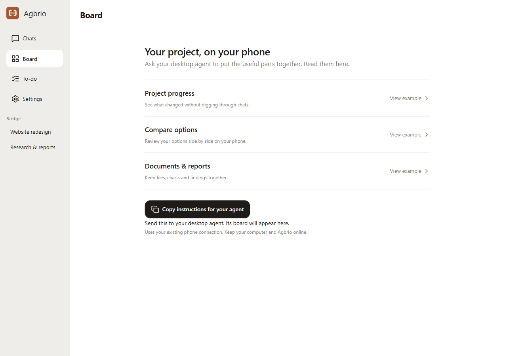

# Start using Agbrio

## Connect your work

[Download the Windows app](https://github.com/geoffrey1111/agbrio/releases/latest), open it and choose Codex, Claude Code or both in the first-run guide. Agbrio configures supported local connections for you; confirm personal permissions when asked. You can skip and reopen setup from Settings. In Chats, choose the conversation you want to follow. To pass work between two conversations, create a Bridge and review the destination before sending.

## Take it to your phone

The same guide prepares the phone connection, offers a hosted trial or activation code, and pairs your phone. Existing HTTPS connections are reused. Follow the iPhone or Android home-screen instructions and enable notifications on the phone when wanted. You can also manage pairing later in Settings → Devices. Keep the computer and Agbrio online.

## Create your first board

Open Board to explore examples. If a board is already connected, choose Create board. Explore a progress page, a comparison or a report, then copy the instructions to your desktop agent. Ask for the content you want; its published board appears here and follows updates to the project files.

## Ask Claude to talk to Codex

In the Agbrio Claude Code plugin, use `/agbrio-bridge:codex` with a Codex conversation link or thread ID and what you want to send or read. Complete the Agbrio MCP connection when prompted. You do not need to bind a Bridge. [Plugin guide](../tools/claude-code-plugin/README.md).

## Need more help?

[Connection walkthrough](SETUP.md) · [Boards](BOARDS.md) · [Connect an assistant](ASSISTANT_CONNECTION_GUIDE.en.md) · [Troubleshooting](FAQ.md)
