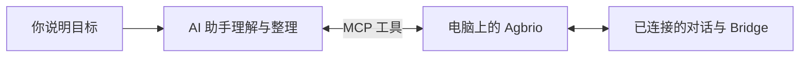

# 用 AI 助手跟进电脑上的任务

把进度、任务交接和需要你决定的问题带回一个管理对话，减少来回切换。

**MCP 是助手调用工具的通用接口。** 助手负责理解任务，Agbrio 按实际权限读取或操作精确绑定的对话，并记录结果。你仍决定授权、接管范围和需要本人回答的问题。[MCP 官方介绍](https://modelcontextprotocol.io/docs/learn/architecture)

## 可以先试什么

| 想完成的事 | 可以怎样告诉助手 |
| --- | --- |
| 少开几个窗口 | “只读汇总我指定任务的进度、阻塞和待决策事项。” |
| 协调规划与执行 | “先问清我选哪个 Bridge、谁规划谁执行，再提出交接方案。” |
| 集中处理决策 | “整理需要我回答的问题，带上来源和选项，等我回答后再继续。” |

具体操作方向以实际工具权限为准。接上 MCP 不等于自动开启后台接管、持续提醒或日报；这些需要客户端支持，并另行设置。

## 从连接到第一次读到结果

电脑需保持开机、联网，Agbrio 保持运行。已经能正常调用工具时，直接从第 5 步开始。

| 步骤 | 在哪里做 | 看到什么再继续 |
| --- | --- | --- |
| **1. 找到入口** | Agbrio「设置 → AI 助手」 | 当前实例的完整 MCP 地址；没有地址时，先到「设置 → 设备」配置入口。云端助手需要可访问的 HTTPS 地址。 |
| **2. 准备授权** | 同一页面 | 复用有效的整个应用授权；没有时由本人创建。可查看到期时间，也可随时撤销。 |
| **3. 添加连接** | 选择你的助手，复制本页指令给它；或打开它的 MCP / 连接器设置 | 添加名为 agbrio 的服务器。使用 Agbrio 显示的完整地址，按所选客户端教程操作。 |
| **4. 本人同意** | 浏览器中的 Agbrio 授权页 | 登录、核对范围并同意，回到目标助手。不要把兑换码或手机配对码填成 MCP 凭据。 |
| **5. 只读试用** | 目标助手对话 | 让它实际调用 `agbrio_read_app`，报告权限范围、审批模式、有效期，再读取你指定的一个任务；先不发送消息。 |
| **6. 交代任务** | 同一个助手对话 | 说明跟进哪些任务、哪些情况必须问你、何时暂停。连接成功不代表所有任务都已委托。 |

应用中的详细教程可以随时跳转步骤；点击“下一步”本身不代表配置成功。

## 卡住时先看这里

- **没有 MCP 地址：** 先配置电脑的访问入口，不必反复创建助手授权。
- **一直提示登录：** 到所选助手的 MCP / 连接器设置中找到 agbrio，完成登录授权。
- **已授权但没有工具：** 确认在实际要用的助手对话里启用了连接，再重新发现工具。
- **只有聊天、没有 MCP 功能：** 提示词不能替客户端安装连接；需要支持相应 MCP 和 OAuth 流程的客户端。
- **能读取但不会主动跟进：** 先按需使用；持续跟进要另行确认事件唤醒能力，不能把手机通知当成助手已被唤醒。

需要求助时提供版本、失败阶段和错误文字即可，不要发送令牌、Cookie 或完整授权跳转网址。
